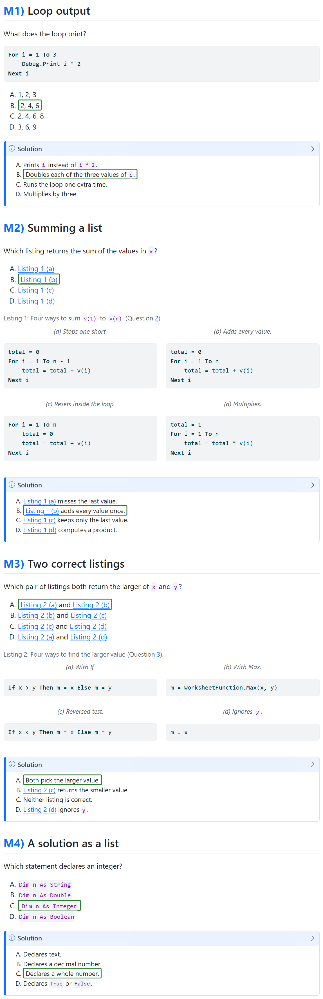
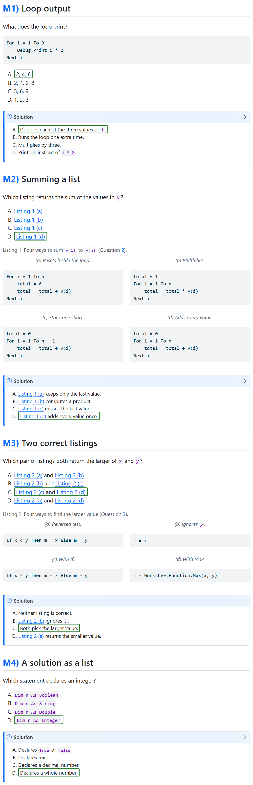

# Quarto Exercise Labels

[](https://github.com/brenobeirigo/quarto-exercise-labels/actions/workflows/checks.yml)

`exercise-labels` is a Quarto filter that numbers exercises in headings. It puts
a label such as `Q1`, `M2`, or `Q2.1` in front of the heading text, gives every
exercise a stable anchor, and records the label in data attributes that styles
and scripts can use. Open questions and multiple-choice items have separate
counters.

Labels are ordinary text, so they appear in HTML, PDF, Word, and Reveal.js
output. HTML output also loads a small stylesheet.

**How-to and live demo:** <https://brenobeirigo.github.io/quarto-extensions/exercise-labels.html>

## Install

```bash
quarto add brenobeirigo/quarto-exercise-labels
```

The repository installs two extensions: `exercise-labels` and
[`neutral-answer-ids`](#neutral-answer-ids). Each one is enabled on its own.
Both run at the `pre-ast` stage, before Quarto turns callouts and
cross-reference targets into its own elements.

## Enable

```yaml
filters:
  - exercise-labels
```

## Mark exercises

### On the heading

| Markup | Result |
|---|---|
| `{.exercise}` or `{.question}` | Open question, labelled `Q` |
| `{.mcq}` or `{.multiple-choice}` | Multiple-choice item, labelled `M` |
| `{data-kind="Q"}` or `{data-kind="M"}` | Chooses the kind explicitly |
| `{#exr-...}`, `{#sec-exercise-...}`, `{#sec-question-...}` | Open question |
| `{#exr-mcq-...}` or `{#sec-mcq-...}` | Multiple-choice item. `{#sec-mcq-setup-...}` is left alone |

```markdown
### Compute the sample mean {.exercise}

### Pick the median {.exercise data-kind="M"}
```

### By section

- Under a level-2 heading with the identifier `exercises`, every level-3 heading
  is an open question. A heading titled "Exercises" gets that identifier
  automatically.
- Under `multiple-choice-exercises` or `multiple-choice-questions`, every
  level-3 heading is a multiple-choice item.
- A level-1 `.exercises` heading whose title mentions multiple choice, or a
  document whose title does, makes every level-2 heading a multiple-choice item.
- `.exercise-tier` headings are never labelled. `.exercise-group` headings
  organise the source and are removed from the output, unless
  `hide-exercise-groups` is `false`.

### Included exercises

```markdown
::: {.exercise-include target-level="3"}

:::
```

The headings inside move so the first one sits at `target-level`, which
defaults to 3, and that first heading becomes the exercise. The kind is `M` when
the include contains an `.alpha-list`, and `Q` otherwise. Add `.exercise-bank`
to label every heading one level below the first one instead.

An include whose first heading has an identifier starting with `sec-setup-`
(or the older `sec-mcq-setup-`) is a shared background for the questions after
it: its headings move, but it gets no label and no number.

A question of a case study can start by including its setup, wrapped in
`::: {.exercise-setup setup="<case>"}`. The setup is never labelled, the
question heading after it is, and when a page holds several questions of the
same case, only the first copy of the setup stays. The setup and the question
each move so that their first heading sits at `target-level`.

An include hands back its content without the wrapping div, so a table of
contents lists both the setup and the question.

A paper host can set two more attributes on an include:

| Attribute | Effect |
|---|---|
| `exercise-label="Question 1"` | Uses this text as the label instead of the counter. An empty value, `exercise-label=""`, shows no label, for a question printed on its own page. |
| `print-start="verso"` | Records `data-print-start` on the question heading, for print stylesheets. The value is `page`, `verso` or `recto`. A heading can carry `print-start` too. |

```markdown
::: {.exercise-include target-level="2" exercise-label="Question 1" print-start="verso"}

:::
```

### Student and answer versions

Set the top-level `exercise-audience` metadata to build a student or an answer
version of a paper from the same sources, usually in two Quarto profiles:

```yaml
# _quarto-questions.yml
exercise-audience: student

# _quarto-answers.yml
exercise-audience: answers
```

Inside exercise includes, a `student` build removes every note callout, such
as a `Solution`, and the `.correct` marker of each correct alternative, so the
page source holds no answer. A note callout with the class `.question-aside`
belongs to the question and stays, unless its title names a solution, answer,
rubric or marking. An `answers` build keeps everything and starts each note
callout collapsed. Without `exercise-audience`, includes stay as written.

### Question groups

With `numbering: hierarchical`, a `.question-group` heading shows "Exercise 1:"
and the exercises under it are numbered `Q1.1`, `M1.2`, and so on. Grouped
exercises are left out of the table of contents, while the group heading stays
in it. The next heading at the group's level or higher ends the group.

```markdown
## Budget a small event {.question-group}

### Add the fixed costs {.exercise}
```

## Options

Set options in a document header or in `_quarto.yml`. A page-specific `prefix`
belongs in that page's header.

```yaml
exercise-labels:
  numbering: flat             # flat | hierarchical
  prefix: ""                  # "2.4" gives 2.4.Q1
  question: Q                 # letter for open questions
  choice: M                   # letter for multiple-choice items
  suffix: ""                  # ")" gives "Q1) Title", inside the label
  separator: ""               # ":" gives "Q1: Title", after the label
  group-label: Exercise       # word before a group number
  max-level: 3                # deeper exercise headings are raised to this level
  hide-exercise-groups: true  # remove .exercise-group headings
```

`max-level` does not apply to exercise includes, whose `target-level` decides
the level, or to hierarchical numbering, which keeps every level.

## Output

- An exercise heading gets the classes `exercise-heading exercise`, then
  `mcq-question` or `open-question`, and the attributes `data-exercise-id` and
  `data-exercise-kind`. A heading with an empty fixed label has no
  `data-exercise-id`.
- The label is `<span class="exercise-label" data-exercise-id="Q1" data-exercise-type="Q">`.
- A question group heading gets the class `question-group-heading` and the
  attribute `data-question-group-id`, and its label span has the class
  `question-group-label`.
- A heading without an identifier gets `exr-<title>` and a
  `data-generated-anchor` attribute.

The bundled stylesheet colours labels with `--exercise-label-color` when set,
then the Bootstrap primary colour, and finally the heading's current text
colour.
It hides Quarto section numbers on exercise headings.
Set the CSS variable on the page or a surrounding container to style both
exercise and question-group labels without changing the generated markup:

```css
:root {
  --exercise-label-color: #315c45;
}
```

The filter does not inject inline colours.
A host theme can still apply a more specific `color` rule directly to the label;
in that case, adapt that rule or add a scoped host stylesheet rule using
`color: var(--exercise-label-color, var(--bs-primary, currentColor))`.
The [Lucid theme](https://brenobeirigo.github.io/quarto-extensions/lucid.html) also
adds a copy-reference button to each label and retitles a callout written as
`title="Solution [-@exr-id]"` to "Solution to Q1".

## Exam versions

A multiple-choice paper gets a new answer key from the same sources with one
flag. Nothing in the questions changes:

```bash
quarto render exam.qmd --profile questions -M exam-version:B
quarto render exam.qmd --profile answers -M exam-version:B
```

Without `exam-version`, or with `false`, the paper renders as written. `A`
keeps the written order but, like any version, prints its key and, on
request, its label. Any other label, such as `B` or `C`, gives its own key,
the same every time, so the student and answer renders always agree.

### Demo

[`example-exam.qmd`](example-exam.qmd) holds five made-up questions, one for
each case. Render its answer view as written and as version B:

```bash
quarto render example-exam.qmd -M exercise-audience:answers
quarto render example-exam.qmd -M exercise-audience:answers -M exam-version:B
```

| Version A, as written | Version B |
|---|---|
|  |  |

To keep the screenshots short, each Solution in the example shows only its
Alternative checks; a full Solution also has an Explanation (see
[Solutions](#solutions)). There is no "**Answer:** C" line: the check marked
`.correct` is the answer, and it moves with its option, so no letter can go
stale.

What changed in version B:

1. **Loop output**, a plain question: the correct option moves from B to A,
   and the explanations follow, with `.correct` still on the right one.
2. **Summing a list**, one listing per option: the correct option moves from
   B to D, and the four listings move with their options, so D shows panel (d)
   and every explanation still names the listing it describes.
3. **Two correct listings**, a pair per option: the correct pair moves from A
   to C. Every letter names the same slots as before, A (a) and (b), B (b) and
   (c), C (c) and (d), D (a) and (d), now filled with the listings that make
   the new key true.
4. **A solution as a list**, the plainest case: the correct option moves from
   C to D, and its explanation goes with it.
5. **An option that refers to the others** ("None of the above") keeps its
   order, and the render says why:

   ```
   WARNING exam-version: question 5 keeps its order: an option refers to the other options
   ```

Each answer view ends with its key: `Key, version A: 1 B, 2 B, 3 A, 4 C, 5 B`
and `Key, version B: 1 A, 2 D, 3 C, 4 D, 5 B`.

A Solution that adds "**Answer:** C" keeps its order, because the letter would
be wrong in version B; the render reports it with the fix, to name the option
by its content.

### Questions

A question is the block that holds one `.alpha-list`: its `.exercise-include`
or, in a paper without includes, the widest section under a heading that holds
no other answer list. The filter changes nothing outside that block, so one
question never affects another.

The `.alpha-list` holds four options, written `A) ...` or `- ...`, and one
`.correct` marker. The options are reordered so the correct one lands on its
new letter.

### Panels

When the options cite listings, figures or tables (`@lst-`, `@fig-`, `@tbl-`)
and the four cited panels are the blocks of one parent in the question, such
as `::: {#lst-x layout-ncol="2"}`, the panels are reordered with the options.
Every letter keeps exactly the panels it named before, in the same order: if A
named "(a) and (b)", the option at A still names "(a) and (b)". A letter the
question cannot reach that way is not used for it.

### Solutions

Each question has one Solution callout, after the question and all its
panels. It has two parts, always in this order and with these headings:

```markdown
::: {.callout-note title="Solution"}

**Explanation**

The worked answer, from the question's own code, data or panels: a trace,
a rule, a table or a derivation. Test code goes at its end.

**Alternative checks**

::: {.alpha-explanations}
A) Counts all 100 inner passes in `P2`.
B) Lets `P1` continue from the `c2` of `P2`.
C) [Gives this output.]{.correct}
D) Adds the two local counters.
:::

:::
```

- **Explanation** reaches the answer without judging the options.
- **Alternative checks** is the same lettered list as the options, one item
  per option in option order, with `.correct` on the correct option's item.
  It is always the last block in the callout.
- Each option is checked once. A wrong option's item names the step or value
  that fails. The correct option's item is a short verdict, because the
  Explanation already gives the reasons.
- When each option is one listing or figure, the panel verdicts are the
  checks, and the Explanation says what a correct version must do.
- When options pair panels ("(a) and (b)"), the Explanation judges each panel
  once, and each check names the panel that makes its option wrong
  ("Includes @lst-sum-b.").
- No option is named by letter, and there is no "**Answer:**" line: the item
  marked `.correct` is the answer.

The checks follow their options in every version, and Pandoc letters them. A bullet list in the block
gets bold **A.** to **D.** labels. Without the block, a Solution's list of four
bullets labelled `**A.**` to `**D.**` follows too, and a first word that
repeats each bullet's own letter ("**A.** A counts") changes only when all
four bullets start that way.

### When a question keeps its order

When in doubt, a question keeps its order and the render says why:

- anything else in the question names a letter A to D: the statement, a hint
  or the Solution, in plain text, bold, a heading, a table or a definition list
  ("**Answer:** B", "Option B", "the same mistake as A", "B) ...");
- an option refers to the others, such as "None of the above";
- its panels cannot move with its options, or another question cites them;
- its block holds more than one answer list or explanation list.

Letters that are clearly data do not count: next to a word such as "column",
"grade" or "band", in a list of single values such as "A, D, 1, C", and the
article "A" before a word that is not a verb. Other data letters, such as
"higher than C", keep the question in place; describe the options instead of
naming their letters to let it move.

### The key

The new key changes every question that can move, keeps the A to D totals
balanced and avoids the same letter on consecutive questions. An answer build
(`exercise-audience: answers`) ends with it, numbered by each answer list's
place on the page. The paper names no version by default; set
`exam-version-label: true` to add "Version B" to the subtitle.

The filter comes with the extension and runs before `exercise-labels`. A
project that loads the filters by path lists `exam-version.lua` first.

## Neutral answer ids

Questions often name their alternatives in identifiers, such as
`lst-fee-correct1` or `fig-cellphone-wrong2`. An identifier is in the page
source, and a reader sees it when hovering a link. Enable the second extension
to rename them in student builds:

```yaml
filters:
  - exercise-labels
  - neutral-answer-ids
```

In a student build, every listing, figure or table identifier that contains
`correct` or `wrong` becomes `<prefix>-option-<n>`, numbered in page order, so
neither the name nor the number gives the answer away. Cross-references, links,
code cell labels and raw HTML follow the new identifiers. Section identifiers
stay.

The build is for answers when `exercise-audience` is `answers`. Without that
option, it is for answers when the active Quarto profiles include `answers`.
An answer build keeps the authored identifiers.

## Examples

- `example.qmd` numbers an Exercises section and an include with a prefix.
- `example-hierarchical.qmd` shows question groups.
- `example-exam.qmd` shows exam versions, with `example-exam.css` marking the
  correct options.

```bash
quarto render example.qmd --to html
```

## Test

```bash
python -m unittest discover -s tests -v
```

## Releases

Install a release with `quarto add brenobeirigo/quarto-exercise-labels@v2.0.1`.
[CHANGELOG.md](CHANGELOG.md) lists every change, and the
[releases page](https://github.com/brenobeirigo/quarto-exercise-labels/releases)
has the notes of each tag.

| Release | What it adds |
|---|---|
| [v2.0.1](https://github.com/brenobeirigo/quarto-exercise-labels/releases/tag/v2.0.1) | A question held for naming a letter is reported with the fix: name the option by its content |
| [v2.0.0](https://github.com/brenobeirigo/quarto-exercise-labels/releases/tag/v2.0.0) | Exam versions work one question block at a time, move panels by any citation pattern and keep a question in place whenever it names a letter |
| [v1.6.0](https://github.com/brenobeirigo/quarto-exercise-labels/releases/tag/v1.6.0) | `.alpha-explanations` takes the same lettered list as the options, with `.correct` |
| [v1.5.0](https://github.com/brenobeirigo/quarto-exercise-labels/releases/tag/v1.5.0) | Enclosed explanations; paired panel options |
| [v1.4.0](https://github.com/brenobeirigo/quarto-exercise-labels/releases/tag/v1.4.0) | Panel questions move with their listings; the version label is opt-in |
| [v1.3.0](https://github.com/brenobeirigo/quarto-exercise-labels/releases/tag/v1.3.0) | `-M exam-version:B` renders a new answer key |
| [v1.2.0](https://github.com/brenobeirigo/quarto-exercise-labels/releases/tag/v1.2.0) | Student and answer builds, fixed labels and `print-start`; the `neutral-answer-ids` extension |
| [v1.0.1](https://github.com/brenobeirigo/quarto-exercise-labels/releases/tag/v1.0.1) | Case-study setups and multiple-choice includes |
| [v1.0.0](https://github.com/brenobeirigo/quarto-exercise-labels/releases/tag/v1.0.0) | First release |

## License

[MIT](LICENSE)
